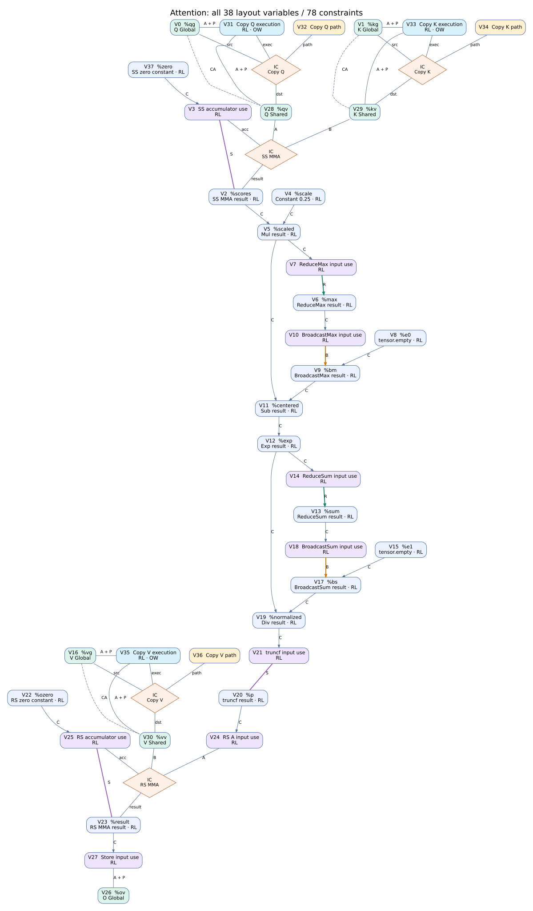
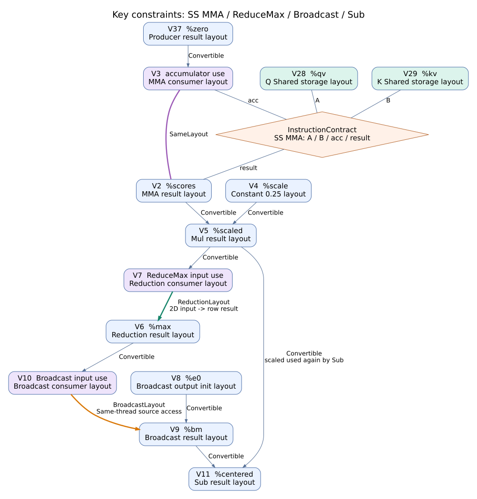

# Frisk 布局推断流水线汇报

## 1 系统解决什么问题

Frisk 布局推断把“只描述数学计算的程序”变成“明确数据如何存储、如何分配给线程、采用什么操作契约的程序”。核心流程是：**先建立约束并选择合法方案，再将布局写入中间表示，验证成功后才提交结果。**

当前系统已完成一个简化 Attention 的整图布局推断：两次 Tensor Core MMA、Softmax 的归约与广播、三次 Global→Shared Copy 和最终输出 Store 可以在同一套布局方案下衔接，无需额外布局转换。

本报告采用 2026-10-11 工作区的 Attention 实例与阶段结果。结论限于布局推断和 IR 合法性，不代表已经完成 Attention 的 GPU 代码生成、数值验证或性能测试。

理解流程只需要区分三类信息：

| 信息                          | 回答的问题                           | 例子                                               |
| ----------------------------- | ------------------------------------ | -------------------------------------------------- |
| Storage layout 存储布局       | 元素位于内存的哪个字节和 bit         | `O[i,j]` 的字节偏移为 `4*(64*j+i)`             |
| Distributed encoding 线程分布 | 哪个线程的哪个逻辑寄存器槽持有元素   | 某线程同时持有第 0 行与第 8 行的归约结果           |
| 操作契约                      | 这些布局能否按某种指令或算法共同执行 | MMA 的 Shared descriptor、Copy 路径、Reduce 作用域 |

IR 是编译器的中间表示；Tensor 表示参与计算的张量值，MemRef 表示存储缓冲区。`layout_view` 为缓冲区绑定存储布局，本身不搬运数据，实际搬运由 Copy 等操作完成。

下文 IR 是实际输入和阶段结果的节选，统一使用便于阅读的 SSA 名称。为压缩篇幅，省略外围 Module/region、部分操作和长 attribute 定义；`#D_S` 等是完整属性的说明性别名。因此片段用于对照阶段变化，不能单独作为完整 MLIR 文件运行。MemRef 类型末尾的 `1` 表示 Global，`3` 表示 Shared。

## 2 贯穿流水线的 Attention 实例

配置为 SM90a、128 线程，即 4 个 warp；单头、单静态 tile。Q/K/V 都是 `64×16xf16`，先从 Global 复制到 Shared；输出 O 为 `64×16xf32`。

```text
scores[64,64]     = Q × Kᵀ                 // SS MMA，两侧输入均在 Shared
scaled[64,64]     = scores × 0.25
max[64]          = ReduceMax(scaled, axis=1)
exp[64,64]        = Exp(scaled - Broadcast(max))
sum[64]          = ReduceSum(exp, axis=1)
p[64,64]         = cast_f16(exp / Broadcast(sum))
result[64,16]    = p × V                   // RS MMA，p 在寄存器、V 在 Shared
Store(result, O)
```

输入有 16 个未指定 encoding 的 Tensor 结果和 7 个未绑定布局的 view。16 个结果包括中间计算值、三个常量和两个 Broadcast 输出占位；7 个 view 对应 Q/K/V/O 的 Global 存储和三块 Shared 存储。

输入已给定 shape、dtype、线程数和 Shared 的 1024 字节对齐，但未固定完整 Storage 布局，也没有提供更强的 Global 对齐保证。

## 3 流水线总览

生产入口为 `--frisk-layout-pipeline`。其中，候选准备、传播和搜索只修改分析数据，**直到物化阶段才将选中布局写入 IR**。

| 步骤              | 作用                                 | 本例的中间结果                                  |
| ----------------- | ------------------------------------ | ----------------------------------------------- |
| 1 克隆 Module     | 隔离修改，失败不污染输入             | 建立工作副本，原程序不变                        |
| 2 规范化          | 将支持的旧表示统一到当前分析形式     | 本例已采用 Tensor 算子，内容不变                |
| 3 入口校验        | 检查目标和遗留表示是否受支持         | 通过，采用 SM90 目标模型                        |
| 4 收集约束图      | 记录各操作和数据连接必须满足的关系   | 38 个变量、78 条约束                            |
| 5 准备有限候选    | 生成具体布局及合法联合组合           | 61 个候选条目                                   |
| 6 单调传播        | 删除无法获得合法支持的候选           | 删除 9 个，剩 52 个                             |
| 7 有界搜索        | 从候选域中选出完整方案               | 5184 种候选组合空间，使用宽度 32 的 beam search |
| 8 必要时受控松弛  | 对允许处理的失败建立独立重试         | 本例初次求解成功，未触发                        |
| 9 验证求解结果    | 检查完整赋值与操作契约是否共同合法   | 整图方案通过验证                                |
| 10 物化并验证 IR  | 写入 encoding、view 布局和操作契约   | 16 个结果已编码，7 个 view 已绑定，0 个布局转换 |
| 11 保留根存储契约 | 防止 view 简化等改写丢失底层布局要求 | 新增 7 个根契约                                 |
| 12 优化布局转换   | 优化衔接并清理内部标记               | 本例提升三个常量、移除 16 个临时标记            |
| 13 最终验证与提交 | 只对完整合法结果替换原 Module        | 验证通过，事务状态为`committed`               |

松弛是传播和求解失败后的条件分支，并非每次搜索后都要放宽约束。下面按处理顺序说明关键作用和实际变化。

## 4 各阶段如何处理这个实例

### 4.1 克隆 规范化与入口校验

系统先复制原始 Module，后续改写都在工作副本上执行。规范化负责消除支持范围内的旧表示差异，不负责预先决定最终布局；Global/Shared MemRef 也不会因此全部变成 Tensor。

本例已使用 `frisk.mma`、`frisk.reduce_tensor` 和 Tensor 算术，规范化前后 IR 内容相同。入口确认目标及表示受支持后进入分析，此时 `%scores` 仍是 `tensor<64x64xf32>`，Q/K/V 的 view 仍没有 Storage 绑定。

下面两段分别摘自输入的 Copy 和 Softmax 位置：

```mlir
// 输入中的存储视图和真实搬运：尚无 layout 或 copy_contract。
%qg = frisk.layout_view %q
  : memref<64x16xf16, 1> -> memref<64x16xf16, 1>
%qv = frisk.layout_view %qs
  : memref<64x16xf16, 3> -> memref<64x16xf16, 3>
frisk.copy %qg[], %qv[] {
  srcExtents = array<i64: 64, 16>, dstExtents = array<i64: 64, 16>
} : memref<64x16xf16, 1>, memref<64x16xf16, 3>

// 省略 MMA 和 Mul；%scaled 是 Mul 结果。Tensor 类型尚无 encoding。
%max = frisk.reduce_tensor %scaled {kind = "max", dim = 1 : i64}
  : tensor<64x64xf32> -> tensor<64xf32>
%e0 = tensor.empty() : tensor<64x64xf32>
%bm = linalg.broadcast ins(%max : tensor<64xf32>)
  outs(%e0 : tensor<64x64xf32>) dimensions = [1]
%centered = arith.subf %scaled, %bm : tensor<64x64xf32>
```

从此处到候选准备、传播、搜索和方案验证结束，以上 IR 都不因布局决策而改变；变化保存在约束图和求解结果中。

### 4.2 收集约束图

图的节点是“待确定的布局或路径变量”，关系是“必须共同满足的条件”，不是简单地一条算子对应一个节点。

本例的 38 个变量包括：7 个 Storage、3 个 Copy 执行布局、3 个 Copy 路径，以及 25 个 Tensor 结果或输入使用位置的布局。78 条约束中，71 条是硬约束，7 条是用于成本评价的软偏好。

输入使用位置简称 **use**：同一个 Tensor 可能交给多个消费者，消费者需要的布局可以独立建模，再判断是否需要转换。下面两张图中的 `V0…V37` 是同一份约束快照中的变量编号，不是算子执行顺序。

#### 全图覆盖全部 38 个变量



[打开全图放大查看](assets/attention_constraints_full.svg)。蓝色框是 Tensor 结果布局，紫色框是输入 use 布局，绿色框是 Storage 布局，青色框是 Copy execution，黄色框是 Copy path。图中除 38 个变量框外，还有 5 个菱形辅助表示联合约束；**菱形不计入变量数**。

| 图中标记     | 约束                       | 本例数量 | 读图方式                                                     |
| ------------ | -------------------------- | -------- | ------------------------------------------------------------ |
| `C`        | Convertible                | 18       | 生产者结果可直接或经合法转换交给消费者                       |
| `S`        | SameLayout                 | 3        | 两端必须采用相同布局，紫色无箭头线                           |
| `R`        | ReductionLayout            | 2        | 从归约输入 use 到行归约结果，绿色箭头                        |
| `B`        | BroadcastLayout            | 2        | 从广播源 use 到广播结果，橙色箭头                            |
| `IC` 菱形  | InstructionContract        | 5        | 一个菱形连接一次 Copy 或 MMA 的全部角色，要求联合合法        |
| `A + P`    | StorageAccess + Preference | 7 + 7    | 同一对端点的访问硬约束与成本软偏好，合并画线，不是一个新约束 |
| `CA`       | CopyAccess                 | 3        | Copy 源与目标存储的对应关系，灰色虚线                        |
| 节点内`OW` | Ownership                  | 3        | 每个 Copy execution 的唯一 writer 要求                       |
| 节点内`RL` | ResourceLimit              | 28       | 对该变量的线程域等资源要求，直接标在节点内                   |

表中合计 78 条约束；其中只有 7 条 `Preference` 是软偏好。单节点约束使用节点标记、多端点联合约束使用菱形，避免为展示而伪造额外变量或两两关系。有箭头的连线按生产者/消费者或输入/结果方向排布，**不表示推断只能单向进行**；约束会参与图上的候选传播与联合求解。

全图没有预填 `D_S/D_R/D_O`：收集阶段只建立关系，布局取值在后续候选准备与搜索中确定。图中 Copy V 分支放在 RS MMA 附近，仅为排版，不表示 IR 中 Copy V 被移到那里执行。

#### 关键子图展示结果布局与输入 use 的衔接



[打开关键子图放大查看](assets/attention_constraints_key.svg)。这张图保留 13 个变量和 SS MMA 的联合约束，省略 Copy、后半段 Softmax、RS MMA、Store，以及节点上的资源标记；节点编号与全图一致。

可以沿图中四处连接理解约束的不同作用：

1. **`V37 → V3` 与 `V3 — V2` 不同。**`V37` 是零常量的真实结果布局，`V3` 是 MMA 消费它时的布局，两者为 Convertible；但 `V3` 与 MMA 结果 `V2` 必须 SameLayout。这允许在进入 MMA 前做合法转换，却不允许累加器 use 与结果各用一套布局。
2. **SS MMA 的四个角色必须一起合法。**菱形同时连接 Q Shared `V28`、K Shared `V29`、累加器 use `V3` 和结果 `V2`，不是分别检查几条两两兼容边。全图中 `V28` 也连接 Copy Q，因此 MMA 能反过来限制前面 Copy 的存储选择。
3. **`V5 → V7 → V6 → V10 → V9` 是归约到广播的完整连接。**两条 Convertible 分别衔接生产者和消费者；ReductionLayout 决定归约输入与行结果的关系，BroadcastLayout 要求广播输出所需源值在同线程可取。这几条边不是同一种“布局相等”。
4. **`V5` 同时影响归约与减法。**一条边进入 ReduceMax 的输入 use `V7`，另一条直接连接 Sub 结果布局 `V11`；广播结果 `V9` 也连接 `V11`。它们共同约束 Sub 的执行分布。本图中的普通 Mul/Sub 按结果布局承接操作数，不额外为每个操作数建立独立 use 节点。

绘图源文件：[全图 DOT](assets/attention_constraints_full.dot)、[关键子图 DOT](assets/attention_constraints_key.dot)。这些图表达的是实际收集到的约束，不是仅按算子顺序绘制的数据流示意图。

### 4.3 准备有限候选与联合支持表

候选来自目标规则、已有布局信息以及沿约束的投影。例如 MMA 提供合法寄存器分布和 Shared descriptor，Reduce 将二维分布投影为行结果分布，Broadcast 从输出分布推导源 use 所需的分布。

本例准备结束共有 61 个候选条目，主要选择空间如下：

| 对象                               | 准备结束的候选                                      |
| ---------------------------------- | --------------------------------------------------- |
| Q/K/V 的各个 Global 或 Shared 变量 | 各有 2 种存储布局，对应无 swizzle 与 swizzle32 方案 |
| O Global                           | 行主序、列主序、XOR 地址重排，共 3 种               |
| 每次 Copy 执行布局                 | `E0/E1/E2/Eall`，共 4 种线程分布                  |
| 每次 Copy 路径                     | `vector/cp.async/tma`，共 3 种                    |
| Softmax 主链                       | `D_S`，二维 `64×64` 分布                       |
| 两个归约结果及 Broadcast 源 use    | `D_R`，一维 `64` 分布                           |
| 第二次 MMA 的累加器及输出          | `D_O`，二维 `64×16` 分布                       |

swizzle 是按规则重排地址位；无 swizzle 不等于普通行主序。`D_S/D_R/D_O` 的具体含义见第 5 节。下面具体展开四种 Copy 执行分布。

#### 四种 Copy 线程分布

三次 Copy 的逻辑 tile 都是 `64×16`，共 1024 个元素，由 4 个 warp、每 warp 32 个线程参与。定义：

- `w ∈ [0,3]`：warp 编号；`l ∈ [0,31]`：warp 内的 lane 编号。
- `r`：线程内逻辑槽编号，不是物理寄存器编号。
- `(i,j)`：该槽对应的 tile 行列坐标；`floor` 表示向下取整，`%` 表示取余。

四种布局都回答同一个问题：**给定线程 `(w,l)` 和槽 `r`，它对应哪个元素 `(i,j)`？**

| 候选     | 每线程槽数及范围    | 行坐标`i`                  | 列坐标`j`     | 每个元素的持有份数 |
| -------- | ------------------- | ---------------------------- | --------------- | ------------------ |
| `E0`   | 8，`r=0…7`       | `floor(l/2) + 16*w`        | `r + 8*(l%2)` | 1                  |
| `E1`   | 8，`r=0…7`       | `floor(l/16) + 2*r + 16*w` | `l%16`        | 1                  |
| `E2`   | 8，`r=0…7`       | `floor(l/4) + 8*r`         | `w + 4*(l%4)` | 1                  |
| `Eall` | 1024，`r=0…1023` | `floor(r/16)`              | `r%16`        | 128                |

直观区别是：

- **E0 按行内连续片段分配**：每线程负责同一行的 8 列，相邻两个 lane 合起来覆盖一整行；每个 warp 覆盖连续 16 行。
- **E1 按固定列分配间隔行**：每线程负责同一列的 8 个元素，行号间隔为 2。lane 0–15 负责该 warp 内的偶数行，lane 16–31 负责奇数行；每个 warp 仍覆盖连续 16 行。
- **E2 按跨行与交错列分配**：每线程负责同一列的 8 个元素，行号间隔为 8；warp `w` 覆盖全部 64 行中的第 `w、w+4、w+8、w+12` 列。
- **Eall 完全复制**：坐标不依赖 lane/warp，每个线程都有整个 `64×16` tile 的逻辑槽位，因此每个元素对应 128 个持有者。

固定 **warp 0**，比较 lane 0 和 lane 1，从槽 0 开始依次得到：

| 候选     | lane 0 的元素坐标                            | lane 1 的元素坐标            |
| -------- | -------------------------------------------- | ---------------------------- |
| `E0`   | `(0,0), (0,1), …, (0,7)`                  | `(0,8), (0,9), …, (0,15)` |
| `E1`   | `(0,0), (2,0), …, (14,0)`                 | `(0,1), (2,1), …, (14,1)` |
| `E2`   | `(0,0), (8,0), …, (56,0)`                 | `(0,4), (8,4), …, (56,4)` |
| `Eall` | `(0,0)…(0,15), (1,0)…(63,15)`，整个 tile | 与 lane 0 相同，整个 tile    |

`E0/E1/E2` 都以 `128×8=1024` 个槽无重复地覆盖 tile；`Eall` 则有 `128×1024=131072` 个槽，存在复制。这些是候选布局的逻辑定义，不代表最终生成了相应数量的物理寄存器，也不代表所有持有者都会写内存；合法 Copy 还必须证明 writer 唯一。

这四种分布决定“哪个线程处理哪个逻辑元素”，并不单独决定其字节地址。实际访问地址还要组合 Global/Shared 的 Storage layout，因此不能仅看 E0 的行内连续性就断言它的内存访问最优。本例后续传播删除 `Eall`，搜索最终为三次 Copy 都选中 `E1`。

#### 联合支持表

系统还准备**联合支持表**：SS MMA 有 4 个合法角色组合，RS MMA 有 2 个，每次 Copy 有 12 个，每次 Reduce 有 1 个输入/输出配对。因此“某候选出现在变量域里”不等于“它能和邻接变量组成合法操作”。

此时全部候选仍在分析图中，Tensor 类型尚未改写。61 是各变量候选条目数之和，不是整图方案数。

### 4.4 单调删减传播

准备阶段结束后，传播只删除候选，不再无限增加新布局。每次删除都会重新检查受影响的关系，直到候选域不再变化。

三次 Copy 都发生如下变化：

```text
执行布局：{E0, E1, E2, Eall} → {E0, E1, E2}
指令路径：{vector, cp.async, tma} → {vector}
```

每次 Copy 删除 3 个条目，共删除 9 个。原因有两类：

- **缺少访问证据**：Global 根只有 1 字节对齐保证，本例仅能证明 `vector_bytes=1`，不足以支持当前 cp.async/TMA 规则；Shared 的 1024 字节对齐不能代替 Global 保证。
- **证明预算不足**：`Eall` 的槽位域为 `1024×32×4=131072`，超过相关证明的 65536 点预算，未取得合法支持。这里是“未能证明”，不是已证明数学上错误。

strict 传播将 61 个条目删到 52 个，后续 common 传播不再删除。剩余域为 6 个变量各 2 个候选、4 个变量各 3 个、28 个变量各 1 个，组合空间为 `2^6 × 3^4 = 5184`。它不代表 5184 个组合都已通过整图验证。

### 4.5 有界搜索与受控松弛

5184 超过默认精确枚举阈值 256，因此采用宽度 32 的 beam search：优先展开当前可行候选较少的变量，检查硬约束，并保留有限个较优的部分方案。完整方案再计算完整代价。

本次进行了 3034 次候选探测，扩展 538 个节点，保留状态数峰值为 32。最终为全部 38 个变量选定取值，并选定匹配的 Copy、MMA 和 Reduce 契约。

选中总代价为 `[8293,608,64,0,428,6144,6,0,0]`，依次对应指令路径与工作量、内存事务、bank conflict、转换与同步、寄存器风险、Shared 与占用率、复制、代码大小、确定性决胜项。比较采用字典序；这些是模型估算，不是 GPU 实测耗时。

#### 具体算例 比较 O 的列主序和行主序

固定其他 37 个变量，只改变输出 O 的 Storage 布局：方案 A 采用实际选中的列主序 `GoCol`，方案 B 改为行主序 `GoRow`。两者都通过整图合法性验证，Store 输入均为 `D_O`，且都不需要布局转换。下面按当前成本模型复算它们的差异；这是固定其他选择后的候选对照，不是 beam search 逐轮历史。

**第一步 将线程槽位转换为字节地址。**Store 的 `D_O` 每线程有 8 槽；取 warp 0、槽 `r=0`，32 个 lane 访问的逻辑坐标为：

```text
i = floor(lane/4)
j = 2*(lane%4)

列主序地址 = 4*(64*j+i)
行主序地址 = 4*(16*i+j)
```

输出为 f32，每个元素覆盖 4 字节。几个具体地址如下：

| lane           | 元素坐标                       | 列主序字节偏移          | 行主序字节偏移         |
| -------------- | ------------------------------ | ----------------------- | ---------------------- |
| 0、1、2、3     | `(0,0)、(0,2)、(0,4)、(0,6)` | `0、512、1024、1536`  | `0、8、16、24`       |
| 4、5、6、7     | `(1,0)、(1,2)、(1,4)、(1,6)` | `4、516、1028、1540`  | `64、72、80、88`     |
| 28、29、30、31 | `(7,0)、(7,2)、(7,4)、(7,6)` | `28、540、1052、1564` | `448、456、464、472` |

**第二步 按一次 warp 访问统计 32 字节 sector。**当前模型按“warp + 寄存器槽组”划分访问批次，同一批次内触及的 sector 去重，不跨批次合并。这里每批次对应一个槽，共 `4 个 warp × 8 槽 = 32` 批。

以上这批访问若从 32 字节对齐的根地址开始：

- 列主序将 32 个 f32 聚成 4 段连续 32 字节区间：`[0,31]、[512,543]、[1024,1055]、[1536,1567]`，触及 **4 个 sector**。
- 行主序分散在 8 行，每行访问 4 个 f32，例如第 0 行访问 `[0,3]、[8,11]、[16,19]、[24,27]`，每行占用一个 sector，共 **8 个 sector**。

但 O 的根地址只有 1 字节对齐保证，不能假设上述理想起点。模型枚举根地址模 32 的相位 `δ=0…31`，以整个访问的最坏总数计分：

```text
单批次 sector 集合 = 所有元素区间 [offset+δ, offset+δ+3]
                      所触及的 floor(byte_address/32) 的集合
Store 事务代价      = max_δ Σ_32批次 |sector 集合|
```

例如 `δ=5` 时，列主序每段 32 字节区间跨越两个 sector；行主序每行最后一个 f32 也跨过 sector 边界。逐批枚举后得到：

| 对比                              | 列主序 GoCol    | 行主序 GoRow     |
| --------------------------------- | --------------- | ---------------- |
| 根相位`δ=0` 时，每批 sector 数 | 4               | 8                |
| 最坏相位下，每批 sector 数        | 8               | 16               |
| Store 的总事务估算                | `32×8 = 256` | `32×16 = 512` |

这解释了为什么本例不能只按 `4096 字节 ÷ 32 = 128` 计算 Store 成本：还要考虑线程访问分批、重复触及 sector 和未知根地址相位。

**第三步 累加整图的 Global 访问。**三次 Copy 的执行布局均为 E1，按相同模型计算源读取：Q、K 每批最坏触及 4 个 sector，V 每批最坏触及 3 个；每次 Copy 也是 32 批。Shared 写入不计入这一 Global 事务项。

```text
Q 读取 = 32×4 = 128
K 读取 = 32×4 = 128
V 读取 = 32×3 =  96

列主序方案的 memoryTransactions = 128+128+96+256 = 608
行主序方案的 memoryTransactions = 128+128+96+512 = 864
```

**第四步 计算其余八个代价分量。**这些选择在两套方案中相同，因此结果也相同：

| 分量                | 本例计算过程                                                                                                                                                              | 结果 |
| ------------------- | ------------------------------------------------------------------------------------------------------------------------------------------------------------------------- | ---- |
| 指令路径与工作量    | 三次 vector Copy 的 load/store：`3×(32+32)=192`；Store：`32`；SS/RS MMA 的 atom 重复工作量：`1+4=5`；两次 Reduce：`2×(64×64−64)=8064`；合计 `192+32+5+8064` | 8293 |
| bank conflict       | Q/K Shared 写入每批最大 bank 上有 2 个不同 4 字节 word，计`2−1=1`；各 32 批。V 写入每批计 0；合计 `32+32+0`                                                          | 64   |
| 转换与同步          | 没有额外布局转换或重物化边                                                                                                                                                | 0    |
| 寄存器风险代理      | 非 use 的分布变量按线程内槽数求和：12 个`D_S` 结果、2 个 `D_R` 结果、2 个 `D_O` 结果，加 3 个 E1 执行变量；`12×32+2×2+2×8+3×8`                                | 428  |
| Shared 与占用率代理 | 三个不同 Shared 根，各`64×16×2=2048` 字节；按根去重后求和                                                                                                             | 6144 |
| 复制代理            | 两个`D_R` 结果的 replication 均为 4，各计额外 `4−1`；其余计 0                                                                                                        | 6    |
| 代码大小增量        | 没有转换或重物化带来的增量                                                                                                                                                | 0    |
| 确定性决胜项        | 本次评价值                                                                                                                                                                | 0    |

bank conflict 项统计的是**每批最拥挤 bank 的不同 word 数减一，再累加**，不是“发生冲突的 bank 总数”。8293 也不是最终机器指令条数，当前工作代理没有逐条给 Mul/Exp/Div 等普通算术计费；428 不是单线程峰值物理寄存器数；复制项 6 不是多复制了 6 个张量元素。

**第五步 按字典序比较，而不是把九项相加。**

```text
A 列主序：[8293, 608, 64, 0, 428, 6144, 6, 0, 0]
B 行主序：[8293, 864, 64, 0, 428, 6144, 6, 0, 0]

第一项：8293 = 8293，继续比较。
第二项：608 < 864，因此 A 优于 B，不需要后面的分量打破平局。
```

这说明在固定其余选择时，列主序 O 的当前模型成本更低，**不是证明整图已经达到全局最优**。另外，Shared bank 项只针对本例图中的 Shared StorageAccess 写入边，不能将 64 解释为整次 Attention 在硬件上的全部 bank conflict。

计算实现见 [SM90CostModel.cpp](../../lib/Dialect/Frisk/Target/SM90/SM90CostModel.cpp) 的访问分批、相位枚举和操作工作量计算，以及 [LayoutCostModel.cpp](../../lib/Dialect/Frisk/Analysis/LayoutCostModel.cpp) 的静态资源代理。以上事务与 bank 数均为编译期模型估算，不是 GPU profiler 测量值。

#### 受控松弛与搜索边界

本例第一次尝试就成功，`relaxations=[]`，没有放宽任何关系。只有出现符合受控松弛条件的空域时，才从原始分析快照建立独立重试，不会随意改变用户硬契约。

**搜索保证返回经过验证的合法方案，但本次有限宽度搜索不保证最优。**事后复算发现，仅替换 Q Global 的存储候选，就能将内存事务估算从 608 降到 576，其余代价项不变；这也是当前搜索质量仍可优化的具体证据。

### 4.6 验证选中方案

系统检查的是所有选择组合在一起是否成立，而不只是每个候选单独是否合法。例如 Copy Q 与 SS MMA 必须认同同一 Shared 地址映射；Reduce 的结果分布必须满足后续 Broadcast；RS MMA 的结果必须能够按选中的 O 存储布局写出。

本例整图验证通过，所有相关生产者和消费者都可以直接衔接，无需额外布局转换。此时方案仍在分析数据中，IR 尚未编码。

### 4.7 物化并验证实际 IR

物化就是把分析方案写进程序：16 个 Tensor 结果获得 encoding，7 个 view 获得 Storage 绑定，Copy/MMA/Reduce 获得相应操作契约。本例插入的 `frisk.convert_layout` 为 0。

以下别名对应实际选中的属性，具体分布和地址映射见第 5 节：

| IR 别名                        | 含义                                                                                |
| ------------------------------ | ----------------------------------------------------------------------------------- |
| `#D_S`、`#D_R`、`#D_O`   | Softmax 二维分布、归约分布、输出分布                                                |
| `#Gq0`、`#Sq0`、`#GoCol` | Q Global、Q Shared、O Global 的选中存储布局                                         |
| `#E1`、`#copy_vector`      | Copy 执行分布，以及同步 vector 搬运契约                                             |
| `#mma_ss`、`#mma_rs`       | 两次 MMA 的完整指令契约，包含 atom、repeats 和 descriptor                           |
| `#reduce_max`                | warp 归约契约，算法为`canonical_fiber_tree_v1`，输出策略为 `broadcast_complete` |

**Copy 增加存储绑定和执行契约。**源/目标 MemRef 的 shape、dtype 和 memory space 不变，存储映射写在 view 的 `layout` 属性中：

```mlir
%qg = frisk.layout_view %q {layout = #Gq0}
  : memref<64x16xf16, 1> -> memref<64x16xf16, 1>
%qv = frisk.layout_view %qs {layout = #Sq0}
  : memref<64x16xf16, 3> -> memref<64x16xf16, 3>
frisk.copy %qg[], %qv[] {
  srcExtents = array<i64: 64, 16>, dstExtents = array<i64: 64, 16>,
  frisk.copy_contract = #copy_vector,
  frisk.execution_layout = #E1, frisk.execution_threads = 128 : i64,
  frisk.vector_bytes = 1 : i64, frisk.writer_policy = "first_owner"
} : memref<64x16xf16, 1>, memref<64x16xf16, 3>
```

**Tensor 链增加 encoding 和操作契约。**下面仅在 Reduce 上展示临时推断标记，其他结果上的同类标记省略；`%zero`、`%scaled`、`%p`、`%ozero` 以及其余 view 的定义也省略：

```mlir
// SS MMA：累加器和结果均为 #D_S；Shared descriptor 在 #mma_ss 内。
%scores = frisk.mma %qv, %kv, %zero {
  m = 64 : i64, n = 64 : i64, k = 16 : i64, trans_b = true,
  frisk.execution_threads = 128 : i64, frisk.mma_contract = #mma_ss
} : memref<64x16xf16, 3>, memref<64x16xf16, 3>,
    tensor<64x64xf32, #D_S> -> tensor<64x64xf32, #D_S>

// Reduce → Broadcast → Sub：二维 #D_S 与一维 #D_R 直接衔接。
%max = frisk.reduce_tensor %scaled {
  kind = "max", dim = 1 : i64, frisk.execution_threads = 128 : i64,
  frisk.reduction_contract = #reduce_max,
  frisk.inferred_result_layout = #D_R
} : tensor<64x64xf32, #D_S> -> tensor<64xf32, #D_R>
%e0 = tensor.empty() : tensor<64x64xf32, #D_S>
%bm = linalg.broadcast ins(%max : tensor<64xf32, #D_R>)
  outs(%e0 : tensor<64x64xf32, #D_S>) dimensions = [1]
%centered = arith.subf %scaled, %bm : tensor<64x64xf32, #D_S>

// 省略 Exp、ReduceSum、Broadcast、Div 和 truncf。
// RS MMA：寄存器 A 为 #D_S，累加器和结果为 #D_O。
%result = frisk.mma %p, %vv, %ozero {
  m = 64 : i64, n = 16 : i64, k = 64 : i64,
  frisk.execution_threads = 128 : i64, frisk.mma_contract = #mma_rs
} : tensor<64x64xf16, #D_S>, memref<64x16xf16, 3>,
    tensor<64x16xf32, #D_O> -> tensor<64x16xf32, #D_O>
%ov = frisk.layout_view %o {layout = #GoCol}
  : memref<64x16xf32, 1> -> memref<64x16xf32, 1>
frisk.tile_store %result, %ov
  : tensor<64x16xf32, #D_O>, memref<64x16xf32, 1>
```

这里可以直接看到：归约后的 `#D_R` 进入 Broadcast，广播输出恢复到 `#D_S`；RS MMA 的 `#D_O` 结果直接交给 Store。中间没有插入 `frisk.convert_layout`。

物化后重新从实际 IR 收集关系，固定已经写入的布局进行验证，**不能通过重新搜索替错误 IR 找另一个可行解释**。这一步检查“方案是否正确落地”，区别于前一步的“方案本身是否合法”。

### 4.8 保留根契约与优化

物化结束时，布局已写在 view 上，但根存储契约仍为 0。保留步骤为 Q/K/V/O 和三块 Shared 分配补上 **7 个 `frisk.storage_contract`**，使底层存储约定不会因后续 view 改写而丢失。

以 Shared Q 为例，新增的是针对根 `%qs` 的契约操作，不是再次搬运数据：

```mlir
// 保留前只有下面的 layout_view；保留后在它之前增加 storage_contract。
frisk.storage_contract %qs {layout = #Sq0} : memref<64x16xf16, 3>
%qv = frisk.layout_view %qs {layout = #Sq0}
  : memref<64x16xf16, 3> -> memref<64x16xf16, 3>
```

随后进行转换优化。本例没有可合并或删除的布局转换，实际变化是三个常量提升到 Module 层，以及清除 16 个 `frisk.inferred_result_layout` 临时标记。Tensor encoding 和根契约保留，3 个 Copy、2 个 MMA、2 个 Reduce、2 个 Broadcast、1 个 Store 均保留。

例如最终 Reduce 保留执行契约和类型中的 `#D_R`，只去掉临时标记；最终 Module 层的常量也仍然有 encoding：

```mlir
// 最终 IR 中位于 Module 层的三个常量。
%ozero = arith.constant dense<0.0> : tensor<64x16xf32, #D_O>
%scale = arith.constant dense<0.25> : tensor<64x64xf32, #D_S>
%zero = arith.constant dense<0.0> : tensor<64x64xf32, #D_S>

// 下列操作仍位于 kernel 的 parallel 内，省略外围结构。
%max = frisk.reduce_tensor %scaled {
  kind = "max", dim = 1 : i64, frisk.execution_threads = 128 : i64,
  frisk.reduction_contract = #reduce_max
} : tensor<64x64xf32, #D_S> -> tensor<64xf32, #D_R>
```

### 4.9 最终验证与事务提交

优化后再次执行 MLIR verifier 和实际布局 verifier，分别检查类型/SSA 合法性与布局契约一致性。若要求统计文件，还须成功写出统计，最后才用工作副本替换原始 Module。

本例最终状态为 `committed`。任一步失败都不提交工作副本，原始 IR 保持不变；这里的提交是编译器 IR 事务，与 Git 提交无关。

## 5 最终选出的布局及衔接实例

### 5.1 Tensor 分布

| 简称    | 使用位置                            | 每线程逻辑寄存器槽 | 每元素持有份数 |
| ------- | ----------------------------------- | ------------------ | -------------- |
| `D_S` | scores、Softmax 二维主链和 f16 的 p | 32                 | 1              |
| `D_R` | ReduceMax、ReduceSum 的 64 个行结果 | 2                  | 4              |
| `D_O` | 第二次 MMA 的累加器和输出           | 8                  | 1              |

三者均使用 128 线程。槽位表示布局中的逻辑位置，不是编译后物理寄存器用量的承诺。

以 warp 0、lane 1 为例，`D_S` 的前四槽对应 `(0,2)、(0,3)、(8,2)、(8,3)`；归约后的 `D_R` 让该线程持有 `max[0]` 和 `max[8]`。Broadcast 分别读取这两个值，得到 `[max[0], max[0], max[8], max[8]]`，恰好满足四个二维元素的减法需求。ReduceSum 后的广播同理。

因此 `D_S → D_R → D_S` 虽然 shape 和分布不同，仍可按归约及广播契约直接衔接，不需要额外 `convert_layout`。这不意味着 Reduce 自身不需要线程协作。

### 5.2 存储与指令选择

| 对象                 | 最终选择                                                                         |
| -------------------- | -------------------------------------------------------------------------------- |
| Q/K Global 与 Shared | 地址函数均为`16*i + 2*(j%8) + 1024*floor(j/8)`，Shared descriptor 无 swizzle   |
| V Global 与 Shared   | swizzle32 排布：令`x=32*i+2*j`，字节偏移为 `x XOR (((x>>7)&1)<<4)`           |
| O Global             | 列主序，字节偏移`4*(64*j+i)`                                                   |
| 三次 Copy            | 均为`E1 + vector`，`vector_bytes=1`，同步执行，选择唯一 writer               |
| SS MMA               | atom`[64,64,16]`，重复 `[1,1,1]`，Q/K 均为 Shared 输入，K 转置               |
| RS MMA               | atom`[64,16,16]`，重复 `[1,1,4]`，p 为寄存器输入，V descriptor 为 swizzle32  |
| 两次 Reduce          | warp 作用域，`canonical_fiber_tree_v1`，结果按 `broadcast_complete` 契约复制 |

表中地址单位为字节，bit offset 均为 0。`E1` 将 `(warp=w, lane=l, 槽=r)` 映射到 `(floor(l/16)+2*r+16*w, l%16)`：例如 warp 0、lane 0 搬运 `(0,0),(2,0),…,(14,0)`，lane 1 搬运相应的第 1 列元素。

Global 与 Shared 即使采用相同逻辑排布，也仍是不同存储空间，必须执行 Copy。O 选成列主序同样不是免费重排既有外部缓冲区：本例未固定外部布局，调用者必须遵守最终契约；若要求固定行主序，应在输入中明确约束。

## 6 汇报结论与当前边界

当前系统已将简化 Attention 从无布局输入完整推进到经过验证的带布局 IR：**38 个变量、78 条约束，候选从 61 个删减到 52 个，一次求解成功，最终 16 个 Tensor 结果编码、7 个 view 绑定、7 个根存储契约，额外布局转换为 0。**

其核心作用不只是为单个算子选择布局，而是让 Copy、Tensor Core MMA、归约、广播和 Store 对同一套数据分布达成一致，并分别验证分析方案与实际改写结果。事务机制保证失败不会留下半完成的程序。

当前边界有两点：有限宽度搜索仍可能遗漏更低代价的合法方案；本例完成的是静态单 tile Attention 的布局推断，不能据此宣称任意 Attention 变体均已支持，或已经取得 GPU 数值与性能结果。

相关材料：[Attention 输入用例](../../test/Transforms/attention-layout.mlir)、[完整推断记录](attention_layout_inference.md)、[生产流水线实现](../../lib/Dialect/Frisk/Transforms/PassPipelines.cpp)。
